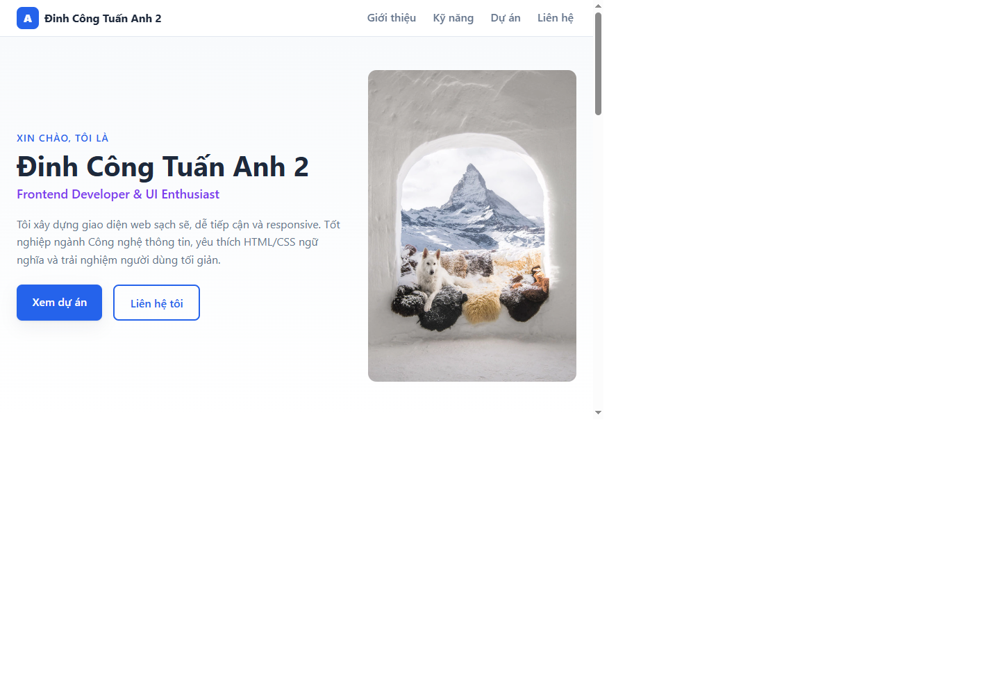
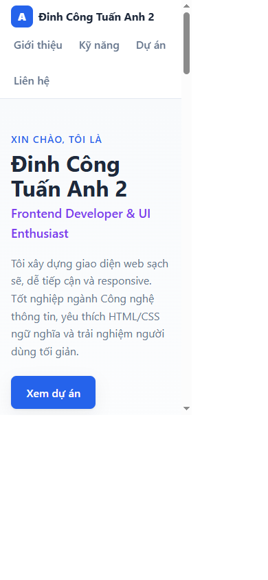

# Báo cáo kiểm thử

## Thông tin kiểm thử

- **Ngày:** 2026-10-27
- **Phạm vi:** Website portfolio tĩnh trong working tree hiện tại (`index.html`, CSS và ảnh trong `assets/`).
- **Môi trường:** Windows, Chromium tích hợp trong VS Code; mở trang qua `file://`.
- **Kích thước viewport:** Desktop 1440 × 1000; mobile 390 × 844.
- **Phương pháp:** Kiểm tra smoke test thủ công kết hợp kiểm tra DOM và ảnh trong trình duyệt. Repository chưa có bộ kiểm thử tự động.

## Kết quả theo tiêu chí

| Tiêu chí | Đánh giá | Kết quả và minh chứng |
| --- | --- | --- |
| **Tính đúng đắn** | Đạt ở mức smoke test | Trang tải được, có đủ bốn khu vực Giới thiệu, Kỹ năng, Dự án và Liên hệ. Cả 5 ảnh tải thành công; bấm liên kết điều hướng Kỹ năng cập nhật URL tới `#skills`. Các thẻ dự án hiện là nội dung giới thiệu, không phải ứng dụng có thể chạy. |
| **UI/UX** | Đạt, còn điểm cần hoàn thiện | Đã kiểm tra ở viewport desktop và mobile; không phát hiện tràn ngang. Có điều hướng, phân cấp nội dung và bố cục responsive. Ảnh hero còn mang tính placeholder; tên hiển thị và thông tin tác giả chưa đồng nhất, các liên kết mạng xã hội/dự án còn là mẫu. |
| **Khả năng vận hành - xử lý lỗi** | Giới hạn | Trang tĩnh mở được trực tiếp từ tệp và các ảnh cục bộ tải bình thường. Không có backend hoặc xử lý bất đồng bộ để kiểm tra luồng lỗi ứng dụng; chưa kiểm thử lỗi khi thiếu tệp, máy chủ trả lỗi hoặc kết nối mạng bị gián đoạn. |
| **Bảo mật** | Đạt ở mức cơ bản; chưa đánh giá đầy đủ | Trong phạm vi mã nguồn được kiểm tra, trang không có script, backend, thông tin bí mật hoặc thư viện bên thứ ba. Chưa chạy công cụ quét bảo mật; HTTPS, security headers và cấu hình máy chủ chưa được đánh giá vì phép thử dùng `file://`. |
| **Chất lượng mã nguồn** | Khá ở mức cấu trúc; thiếu kiểm tra tự động | HTML sử dụng các phần tử ngữ nghĩa, ảnh có `alt`, CSS được tách riêng và có breakpoint responsive. Chưa có cấu hình lint, test tự động hoặc quy trình CI; nội dung mẫu và tên tác giả chưa nhất quán cần được rà soát. |
| **Khả năng triển khai** | Có thể triển khai dạng static; chưa xác minh production | Trang hoạt động khi mở trực tiếp và có thể phục vụ bằng static hosting. Repository chưa có Dockerfile, cấu hình CI/CD hoặc cấu hình máy chủ; chưa thực hiện triển khai lên môi trường production. |

## Ảnh minh chứng

Ảnh được chụp trực tiếp từ trang đang chạy trong Chromium và lưu trong `docs/screenshots/`.

### Desktop - 1440 × 1000

### Mobile - 390 × 844

## Hạn chế và đề xuất

- Thay ảnh placeholder, email mẫu và các liên kết `href="#"` bằng nội dung thật.
- Đồng bộ tên hiển thị giữa tiêu đề trang, metadata, phần giới thiệu và chân trang.
- Bổ sung kiểm thử tự động hoặc checklist smoke test chạy trước khi phát hành.
- Nếu triển khai công khai, kiểm tra HTTPS, security headers, trang lỗi 404 và quy trình triển khai thực tế.
